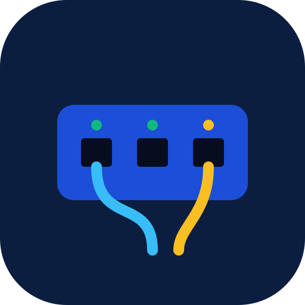
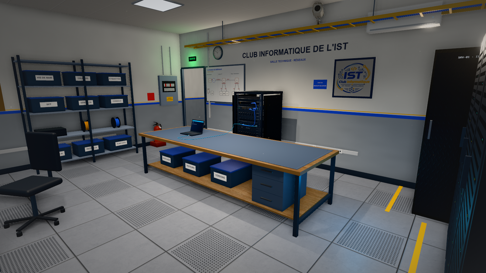
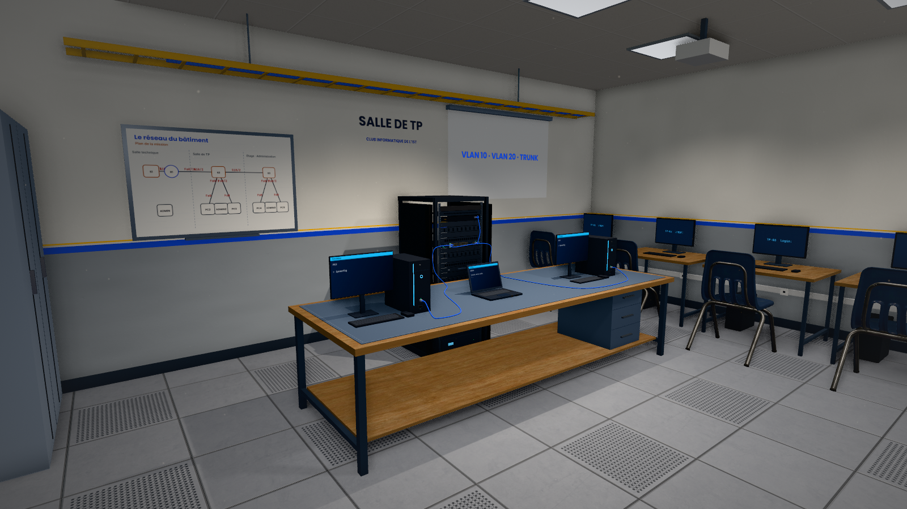
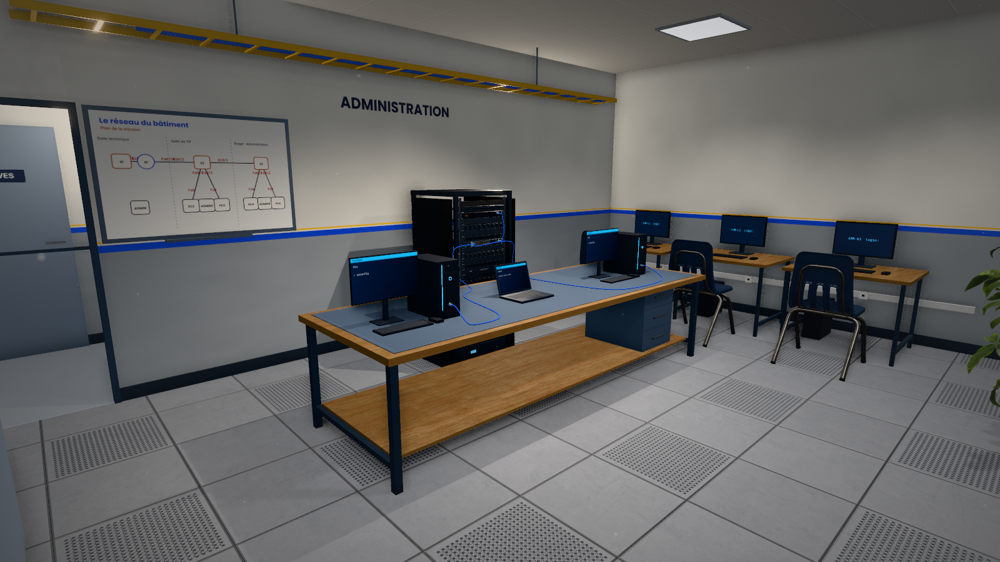
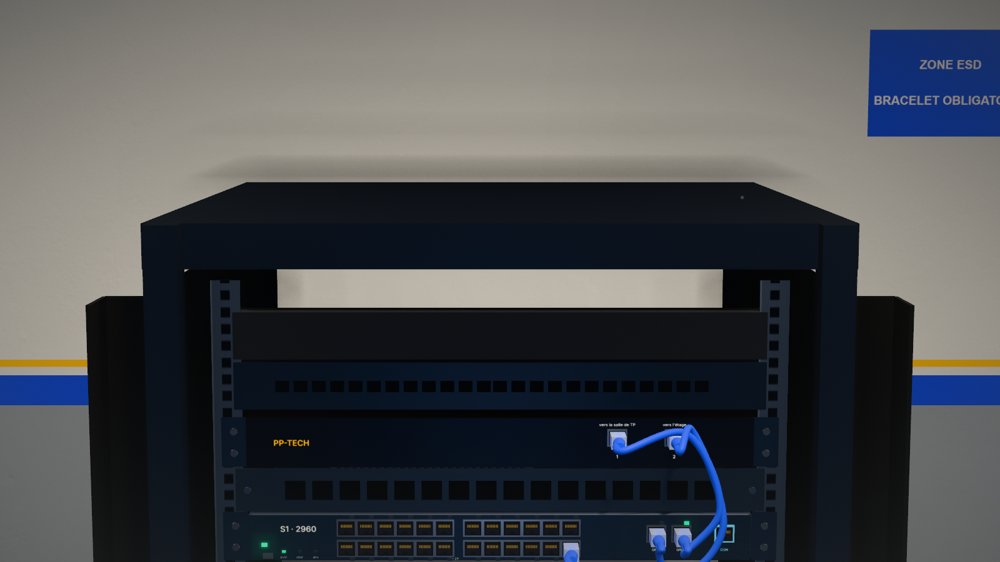
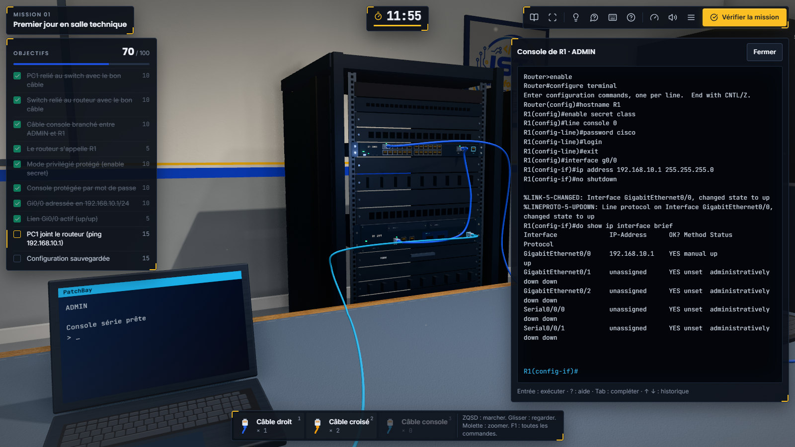
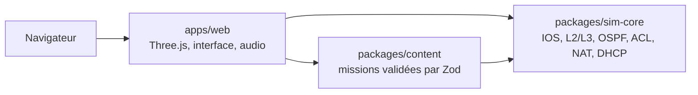

<div align="center">



# PatchBay

Jeu de simulation en 3D pour apprendre les réseaux Cisco sur le terrain, en vue à la première personne

Un projet du **Club Informatique de l'IST**, Ouagadougou

[](https://github.com/RBonsa404/PatchBay/actions/workflows/ci.yml)




</div>

---

## Sommaire

- [Présentation](#présentation)
- [Le jeu](#le-jeu)
- [Missions](#missions)
- [Captures](#captures)
- [Architecture](#architecture)
- [Démarrage rapide](#démarrage-rapide)
- [Commandes](#commandes)
- [Tests et contrôles qualité](#tests-et-contrôles-qualité)
- [Déploiement](#déploiement)
- [Structure du dépôt](#structure-du-dépôt)
- [Documentation](#documentation)
- [Mentions](#mentions)

## Présentation

PatchBay met l'élève dans la peau d'un technicien réseau. Il marche dans un bâtiment, choisit ses câbles, cherche le bon port, ouvre une console IOS et configure le matériel. La note ne vient pas d'un questionnaire : elle vient de l'état réel du réseau simulé.

Trois principes guident le projet :

- **Le réseau est vraiment simulé.** Un `ping` parcourt les câbles, les VLAN et les trunks, trame par trame. Un mauvais câble ou un oubli de `no shutdown` se paie comme sur du vrai matériel.
- **La pratique d'abord.** On apprend en branchant et en dépannant, contre la montre, comme en entreprise.
- **Aucune installation.** Le jeu tourne dans un navigateur et continue de fonctionner sans connexion après une première visite.

## Le jeu

| Domaine | Ce qu'on y trouve |
|---|---|
| Déplacement | vue à la première personne, salles, couloirs, escalier et étage ; il faut se rendre devant un appareil pour le toucher |
| Câblage | câbles droits, croisés, console et série ; panneaux de brassage ; voyants de lien réels ; câbles rangés qui contournent les objets |
| Console IOS | modes, abréviations, `?`, Tab, historique, messages d'erreur fidèles |
| Réseau | VLAN, trunk 802.1Q, router-on-a-stick, routage statique, OSPF, ACL, NAT, DHCP, ARP, ICMP |
| Poste client | invite de commandes : `ipconfig`, `ipconfig /renew`, `ping`, `tracert`, `arp -a` |
| Évaluation | chrono, note sur 100 (objectifs et rapidité), rangs S à D, trois étoiles, mode examen |
| Accompagnement | tutoriel guidé, indices, schéma de la mission au tableau blanc, Aïcha qui répond avec sa fiche hors ligne, et avec une IA en option |
| Visualisation | paquets animés sur les câbles : ARP, requêtes, réponses, erreurs, DHCP |
| Accessibilité | jeu complet au clavier (liste des ports), mouvement réduit, contraste renforcé, tactile et manette |

## Missions

| # | Mission | Lieu | Compétences | Temps |
|---|---|---|---|---|
| 1 | Premier jour en salle technique | salle technique | câblage, console, configuration de base, sauvegarde | 12 min |
| 2 | Relier les deux salles | salle technique | liaison série, horloge DCE, routes statiques | 15 min |
| 3 | Deux salles, deux VLAN | salle technique et salle de TP | VLAN, trunks, routage inter-VLAN | 25 min |
| 4 | Le réseau du bâtiment | rez-de-chaussée et étage | brassage, trois switches, DHCP par VLAN | 45 min |

Chaque mission existe aussi en mode examen : 30 % de temps en moins, sans indice ni assistant, objectifs non cochés.

## Captures

| | |
|---|---|
|  |  |
|  |  |

## Architecture



| Composant | Technologies |
|---|---|
| Moteur (`sim-core`) | TypeScript pur, sans dépendance au navigateur |
| Contenu (`content`) | missions en JSON, schéma Zod, solution de référence rejouée par les tests |
| Jeu (`web`) | Three.js, rendu physique, occlusion ambiante, ombres douces, Web Audio ; interface sans framework |
| Qualité | Vitest, ESLint, TypeScript strict, GitHub Actions |
| Hébergement | site statique : n'importe quel hébergeur de fichiers convient |

Le moteur ne connaît rien de la 3D, et la 3D ne réimplémente aucune logique réseau. Toute mission est testée automatiquement : non résolue au départ, résolue à 100 % par sa solution, erreurs typiques détectées.

## Démarrage rapide

**Prérequis :** Node.js 20 ou plus récent, un navigateur avec WebGL2, 8 Go de mémoire conseillés. Pour jouer en ligne, une connexion stable est conseillée au premier lancement : le jeu charge ses textures et ses modèles 3D.

```bash
git clone https://github.com/RBonsa404/PatchBay.git
cd PatchBay
npm install
npm run dev -w @patchbay/web
```

Le jeu s'ouvre sur http://127.0.0.1:5180.

**Commandes en jeu :** ZQSD ou flèches pour marcher, Maj pour courir, glisser pour regarder, molette pour zoomer, double-clic pour s'approcher d'un appareil, clic droit pour débrancher. T ouvre le tableau, H interroge Aïcha, P liste les ports, M coupe la musique, N passe au morceau suivant.

## Commandes

| Commande | Rôle |
|---|---|
| `npm run dev -w @patchbay/web` | serveur de développement |
| `npm run build -w @patchbay/web` | version de production dans `apps/web/dist` |
| `npm run preview -w @patchbay/web` | essai local de la version de production |
| `npm test` | tous les tests |
| `npm run typecheck` | vérification des types |
| `npm run lint` | analyse statique |

## Tests et contrôles qualité

229 tests couvrent le moteur et les missions : sessions IOS comparées à des sorties de référence, commutation, routage, OSPF, ACL, NAT, DHCP, et résolution complète de chaque mission. GitHub Actions les relance à chaque envoi, avec le contrôle des types, l'analyse statique et la construction.

## Déploiement

Le jeu est un site statique. Le guide pas à pas pour le publier gratuitement est dans [docs/08-deploiement.md](docs/08-deploiement.md).

| Réglage | Valeur |
|---|---|
| Commande de construction | `npm run build -w @patchbay/web` |
| Dossier publié | `apps/web/dist` |
| Node.js | 20 ou plus récent |

## Structure du dépôt

```text
PatchBay/
├── apps/
│   ├── web/            le jeu : scène 3D, interface, audio, PWA
│   └── preview/        outil de vérification du moteur
├── packages/
│   ├── sim-core/       le moteur de simulation et ses tests
│   └── content/        les missions et leur schéma
├── functions/        l'API d'Aïcha (Cloudflare Workers ou Pages), facultative
├── docs/               vision, spécifications, décisions, captures
└── .github/workflows/  intégration continue
```

## Documentation

| Document | Sujet |
|---|---|
| [00-vision](docs/00-vision.md) | vision du projet |
| [01-architecture](docs/01-architecture.md) | architecture |
| [02-mvp-spec](docs/02-mvp-spec.md) | spécification du contenu |
| [03-ios-cli-spec](docs/03-ios-cli-spec.md) | fidélité de la console IOS |
| [04-level-format](docs/04-level-format.md) | format des missions |
| [05-roadmap](docs/05-roadmap.md) | avancement et suite |
| [06-charte-club-ist](docs/06-charte-club-ist.md) | charte graphique du club |
| [07-grands-reseaux](docs/07-grands-reseaux.md) | réseaux sur plusieurs salles et étages |
| [08-deploiement](docs/08-deploiement.md) | mise en ligne gratuite |
| [adr/](docs/adr/) | décisions d'architecture |

## Mentions

Les musiques et les bibliothèques tierces sont libres ; leurs sources et licences sont listées dans [apps/web/ASSETS.md](apps/web/ASSETS.md). Le reste du contenu visuel est créé pour le projet.

PatchBay est un projet pédagogique indépendant, sans lien avec Cisco Systems. Cisco, IOS et Catalyst sont des marques de Cisco Systems, Inc. Le jeu ne contient ni logiciel, ni support de cours, ni logo Cisco.
